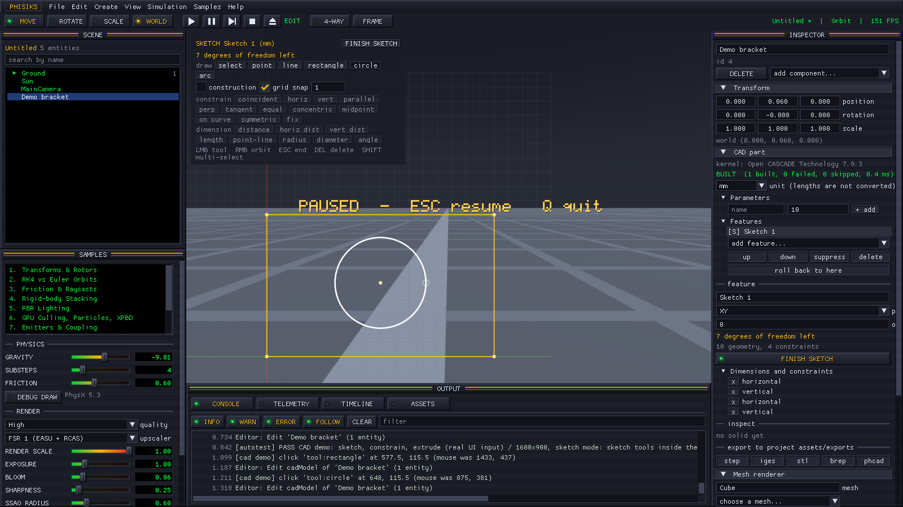
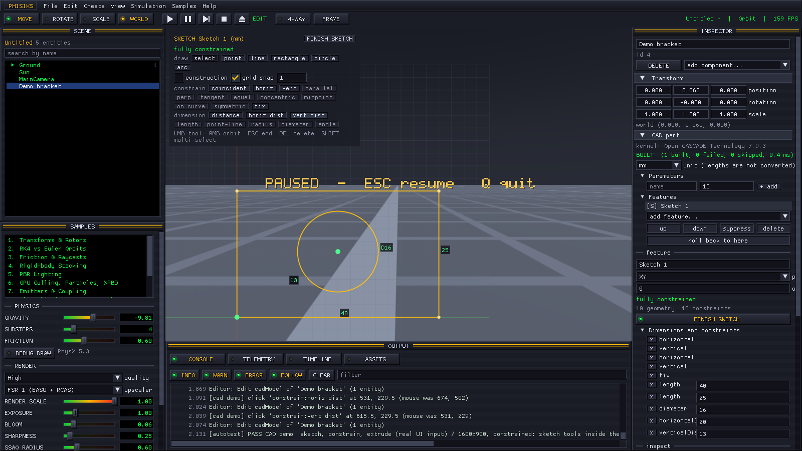
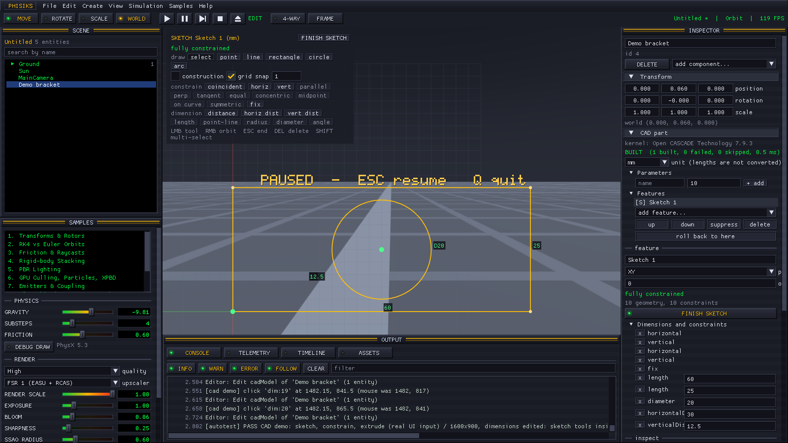
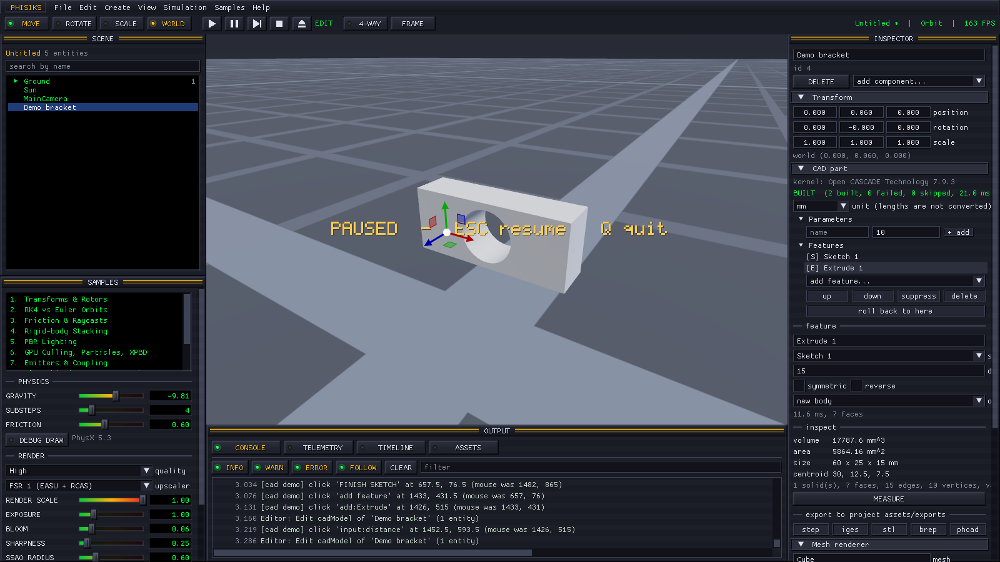

# CAD modelling in PHISIKS

PHISIKS has a parametric part modeller: constrained 2D sketches, a feature history (extrude,
revolve, primitives, fillet, chamfer, booleans, patterns, mirror, import) driven by named parameters,
on an exact boundary-representation (B-rep) geometry kernel, Open CASCADE Technology. A part is a
scene entity, so it is saved with the scene, undone and redone with the editor's history, kept
unchanged by play mode, and reachable from the SDK and the agent interface (PAI).

It is a credible modelling workspace for engineering visualisation and simulation set-ups. It is
**not** a replacement for a commercial CAD suite: see the limitations at the end.

| Layer | Where | Depends on |
|---|---|---|
| Sketch geometry, constraints, solver | `engine/include/Phisiks/Cad/Sketch.h` | glm |
| Expressions, parameters | `Phisiks/Cad/Expression.h` | - |
| Parametric document: features, history, regeneration, `.phcad` JSON | `Phisiks/Cad/Document.h` | the kernel interface |
| Geometry kernel interface (PHISIKS-owned) | `Phisiks/Cad/Kernel.h` | - |
| Kernel implementation | `engine/src/cad/KernelOcct.cpp` | Open CASCADE 7.9.3 (private) |
| Library | `PhisiksCad` (shared), SDK target `Phisiks::Cad` | |
| Scene component | `cadModel` (`CadModel` in `Phisiks/Scene/Components.h`) | PhisiksCore |
| Editor workspace | `apps/editor/src/EditorCad.cpp` | PhisiksEditor |
| Agent interface | `cad.*` methods (`docs/PAI.md`) | PhisiksPAI |

## 1. Geometry kernel decision

**Choice: Open CASCADE Technology 7.9.3, behind a PHISIKS-owned interface.**

The engine's existing geometry (triangle meshes for rendering and physics) cannot represent exact
curved surfaces, make robust booleans of solids, round edges or read STEP / IGES. A B-rep kernel is
required for genuine CAD. Options considered:

| Option | Assessment |
|---|---|
| Open CASCADE Technology (OCCT) | Mature B-rep kernel: primitives, sweeps, booleans, fillets / chamfers, healing, meshing, STEP / IGES / STL. LGPL-2.1 with an exception that allows linking from closed or permissively-licensed code. CMake build, Windows / Linux / macOS. **Chosen.** |
| In-house mesh modeller | No new dependency, but mesh booleans and fillets are fragile, there is no exact geometry and no STEP / IGES. Not credible as CAD. |
| Commercial kernels (Parasolid, ACIS, ...) | Not redistributable in an open project. |
| Other open kernels (e.g. libfive / SDF, CGAL Nef polyhedra) | Implicit or polyhedral only; no standard B-rep exchange. |

**Licence and redistribution.** OCCT is linked only by `PhisiksCad`, a shared library; OCCT itself is
built as shared libraries and shipped unmodified next to it, with its licence texts
(`THIRD_PARTY_LICENSES/OpenCASCADE/`). Users can replace those libraries, as the LGPL requires. See
`THIRD_PARTY_NOTICES.md`.

**Build.** `python tools/build_occt.py` downloads the pinned source (tag `V7_9_3`, SHA-256 checked) and
builds only FoundationClasses, ModelingData, ModelingAlgorithms and DataExchange, with no third-party
products (no FreeType, FreeImage, ffmpeg, OpenVR, TBB, jemalloc, X11 or OpenGL), into `vendor/occt`.
The official Windows binaries were not used: their `TKernel.dll` depends on a debug TBB DLL and
jemalloc, and their data-exchange toolkits pull in the visualisation stack. CI builds the same
subset on each platform and caches it.

**Isolation.** Nothing outside `KernelOcct.cpp` includes an OCCT header. Other code sees
`Phisiks::Cad::Shape` (an opaque, reference-counted, immutable handle) and the functions of
`Kernel.h`. Built with `-DPHISIKS_CAD_KERNEL=None`, PHISIKS has no OCCT at all: sketches and documents
still work, and every solid operation reports "no geometry kernel".

**Cost.** The OCCT subset adds about 40 MB of shared libraries to a package (measured sizes are in
`RELEASE_NOTES.md`). It is loaded only by programs that link PhisiksCad (the editor, the runtime
tests, SDK applications that use CAD); the engine core does not depend on it.

## 2. Sketches

A sketch lives on a plane: XY, XZ or YZ of the part, or a custom frame, moved along its normal by an
`offset` expression.

**Geometry.** Points; lines (two points); circles (centre point and radius); arcs (centre, start
and end points, counter-clockwise; the solver keeps both ends at one radius). Any geometry can be
**construction** geometry: it takes part in constraints but not in profiles.

**Constraints** are equations solved together:

| Geometric | Dimensions (values or expressions) |
|---|---|
| coincident, horizontal, vertical (lines or two points), parallel, perpendicular, tangent (line-circle, circle-circle, keeping the side chosen when created), equal (lengths or radii), concentric, point on line, point on circle, midpoint, symmetric (two points about a line), fix | distance, horizontal distance, vertical distance, line length, point-to-line distance, radius, diameter, angle (degrees) |

**Solver.** A damped Gauss-Newton (Levenberg-Marquardt) solver with a minimum-norm step, so an
under-constrained sketch moves as little as possible. After solving it reports:

- the **degrees of freedom** left: free parameters minus the rank of the constraint Jacobian (0 = fully
  constrained);
- **redundant** constraints (equations that add no rank);
- **failure**: if the constraints cannot all be satisfied, the sketch is left exactly as it was and the
  conflicting constraints are reported.

**Profiles.** Closed loops of lines and arcs (joined by shared or coincident points) and full
circles become profiles. Nested loops become holes (even / odd nesting). Open chains, branches and
zero-area loops are reported as errors, naming where the problem is.

## 3. Parameters and features

**Parameters** are named expressions: `width = 40`, `half = width / 2`. Expressions support
`+ - * / ^`, parentheses, `pi`, `sqrt abs min max sin cos tan asin acos atan` (degrees).
Circular references and unknown names are refused. Every numeric field of every feature and every
sketch dimension can be an expression.

**Features**, in history order:

| Feature | Parameters | Result |
|---|---|---|
| Sketch | plane, offset | profiles for later features |
| Extrude | sketch, distance, symmetric, reverse | new body, or join / cut / intersect with a target body |
| Revolve | sketch, axis (sketch x, sketch y or a sketch line), angle | new body or join / cut / intersect |
| Box, Cylinder, Sphere | sizes, position, axis | new body or join / cut / intersect |
| Fillet, Chamfer | radius / distance, edges (picked) or every edge | modifies a body |
| Boolean | union / subtract / intersect, target body, tool body | modifies the target; the tool body is consumed |
| Linear / circular pattern | count, spacing or angle, direction / axis; repeat a feature's tool (e.g. a cut) or the whole body | modifies a body |
| Mirror | plane origin and normal, keep original | modifies a body |
| Import | a STEP / IGES / BREP / STL project asset | new body or join / cut / intersect |

**Dependencies.** A feature can use only sketches and bodies created before it. Moving a feature
before something it uses, or deleting a feature that others use, is refused with the names of the
dependents.

**Regeneration.** Any change rebuilds the whole history from the first feature. Each feature
reports its own error; features that depend on a failed one are marked *skipped*, and independent
features still build. **Suppress** removes a feature from the build without deleting it; **roll back**
builds the history only up to a chosen feature (new features are inserted there).

**Edge references.** Fillets and chamfers refer to edges by where they are (midpoint and
direction). After the model changes, the nearest edge with the same direction is used; if none is
close enough the feature fails with "edge reference lost" instead of rounding a different edge.
This is a deliberate, documented simplification of the topological-naming problem.

**Units.** A document has one unit: mm (default), cm, m or inch. Changing it does not convert values
(it reinterprets them). In a scene the part is scaled to metres. STEP and IGES files are read and
written in millimetres and converted to the document unit.

## 4. The CAD workspace in the editor

- **Create > CAD part (parametric block)** creates a part with parameters `width`, `length`, `depth`, a
  fully constrained rectangle sketch and an extrude. **Create > CAD part (empty)** starts from nothing.
- Select the part: the inspector shows **CAD part**: build status and time, unit, parameters (add,
  edit, remove), the feature list (status, suppressed, errors; up / down, suppress, delete, roll back),
  **add feature**, the selected feature's properties, **inspect** and **export**.
- **Sketch editing** (EDIT SKETCH): the sketch plane is drawn in the viewport with a grid. Tools:
  select (click, shift-click, drag points), point, line (chains; nearly horizontal / vertical lines get
  the constraint), rectangle, circle, arc. Snapping to existing points (a shared point is a
  coincidence) and to the grid. A tool window offers the constraints and dimensions that fit the
  selection, shows the degrees of freedom, and dimension values are edited in the inspector (a number
  or an expression). DEL deletes, ESC ends the current tool. Edits that would over-constrain the
  sketch are refused with the solver's message.
- **Picking**: PICK EDGES on a fillet or chamfer shows the edges of the body it starts from; click to
  add or remove. MEASURE: click faces or edges for their type, area, length, radius and normal; two
  picks show the minimum distance (and the angle between two faces).
- **Inspect**: volume, area, size, centroid, solid / face / edge / vertex counts, validity (the kernel's
  topology and geometry check).
- **Export** writes `<project>/assets/exports/<part>.step | .igs | .stl | .brep | .phcad` and refreshes
  the asset browser.
- **Assets**: STEP / IGES files in the project (type `cad`) can be added to the scene or assigned to
  an entity: they become a part with an **Import** feature that keeps the exact geometry in the
  document, so the scene reopens without the file (RELOAD FROM ASSET reads it again). `.phcad` files
  (type `cad-document`) open as the parametric part they contain. STL imports are faceted shells, not
  editable parametric models.
- **Undo / redo**: every CAD edit (a parameter, a feature field, a sketch edit, a whole point drag) is
  one undo step, because it rewrites the `cadModel` component the history tracks.
- **Play mode**: CAD editing is disabled while playing; stopping restores the authored part.

### Walkthrough (captured from the editor)

`PHISIKS_DEMO=cad PhisiksRuntimeTests --autotest --hidden --run-dir <dir>` replays this session
with injected mouse and keyboard input only, and checks the result (volume 17787.611 mm^3, exact).
With `PHISIKS_WINDOW_SIZE=WxH` (and `PHISIKS_UI_SCALE`) it also checks that the sketch tool panel stays
inside the viewport with every tool visible; verified at 1280x720, 1366x768, 1600x900 and 1920x1080
(100 %), 1920x1080 (125 %), 1920x1080, 2560x1440, 1280x720 and 1366x768 (150 %). Screenshots at
1600x900, 100 %:

| | |
|---|---|
|  | rectangle and circle drawn with the mouse: 7 degrees of freedom |
|  | fix, two lengths, diameter, horizontal / vertical distance: fully constrained |
|  | dimensions typed in the inspector: 60 x 25 mm, a 20 mm hole at (30, 12.5) |
|  | extruded 15 mm: one valid solid, 7 faces |

## 5. File format

A part document (inside `cadModel.document` in scene files, or a `.phcad` file) is JSON:

```json
{ "format": "phisiks-cad", "version": 1, "unit": "mm",
  "parameters": [ { "name": "width", "expression": "40" } ],
  "features": [
    { "id": 1, "type": "sketch", "name": "Profile", "plane": "XY", "values": { "offset": "0" },
      "sketch": { "geometry": [ { "id": 1, "type": "point", "x": 0, "y": 0, "fixed": true }, "..." ],
                  "constraints": [ { "id": 9, "type": "length", "a": 5, "value": 40, "expression": "width" }, "..." ] } },
    { "id": 2, "type": "extrude", "sketch": 1, "op": "new", "values": { "distance": "10" } } ],
  "nextId": 3 }
```

Documents with a newer `version` are refused rather than misread. Scene files without CAD parts
are unchanged.

## 6. Performance (measured)

Measured in the editor (runtime test, Release build, Windows, Intel UHD laptop): total time to
regenerate, measure, tessellate and upload the part.

| Part | Regeneration | Triangles |
|---|---|---|
| sketch (fully constrained rectangle, 2 dimensions) + extrude | 5-18 ms (first build 18 ms) | 12 |
| the same with a 2 mm fillet on all 12 edges | 107-131 ms | 1380 |
| re-import of that part from STEP (exact geometry) | 111 ms | 1380 |

The kernel libraries add about 46 MB to the Windows package (`TK*.dll`, the OCCT subset).

Regeneration runs on the editor's main thread when a part changes. A large imported assembly or a
long history with many fillets can take noticeably longer; the build time of each feature is shown in
the inspector.

## 7. Limitations

- Single-part modelling. There are no assemblies with mates or joints between parts (parts are
  ordinary scene entities that can be parented and positioned).
- No sweeps along paths, lofts, shells, drafts, variable-radius fillets, threads or sheet metal.
- Sketches: no splines, ellipses, offsets, trims or projections of model edges; sketches on faces
  capture the face plane when created (not associative).
- Edge references for fillets and chamfers are geometric (see section 3), not a full
  topological-naming solution: big changes to the model can require reselecting edges.
- No drawings, tolerancing (GD&T) or PMI. STEP export writes geometry only (AP214 shape, no colours or
  assembly structure).
- The solver is numerical (it does not decompose the sketch); very large sketches (hundreds of
  constraints) solve more slowly.
- Regeneration is not incremental: every change rebuilds the whole history.
